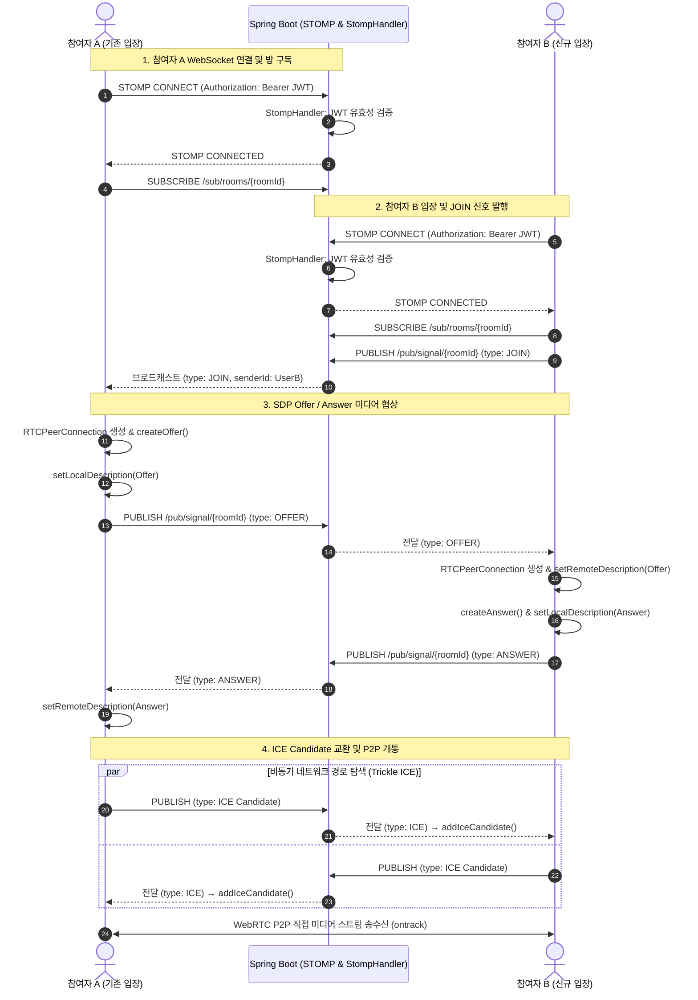

# ConnectRTC — WebRTC 기반 실시간 화상회의 서비스

> Spring Boot(WebSocket/STOMP) 시그널링 서버와 React(TypeScript)를 결합하여 구현한 실시간 P2P 화상회의 웹 애플리케이션입니다.

- **개발 기간:** 2026.11 ~ 2026.11 (1인 개발)
- **GitHub:** [리포지토리 링크]
- **시연 영상 / 배포 링크:** [링크 또는 GIF 첨부]

---

## 1. 프로젝트 개요 및 기획 의도
- HTTP 기반 REST API와 실시간 양방향 통신(WebSocket/STOMP), 브라우저 간 직접 미디어 스트림을 교환하는 WebRTC의 동작 원리를 통합적으로 설계하고 구현하기 위해 진행한 프로젝트입니다.
- 중앙 미디어 서버 부하를 줄이는 P2P(Mesh) 구조를 채택하고, 시그널링 과정에서의 비인가 접근을 차단하기 위해 HTTP와 WebSocket 계층 모두에 JWT 인증을 적용했습니다.

---

## 2. 기술 스택

### Backend
- **Language & Framework:** Java 21, Spring Boot 4.1.2
- **Security & Auth:** Spring Security, JWT (jjwt)
- **Real-time Signaling:** Spring WebSocket, STOMP, SockJS
- **Database & ORM:** MySQL, Spring Data JPA, Jasypt

### Frontend
- **Language & Framework:** TypeScript, React 19, Vite
- **Networking & Media:** Axios, `@stomp/stompjs`, `sockjs-client`, WebRTC API
- **Routing & Styling:** React Router, CSS (컴포넌트별 스타일시트 분리)

---

## 3. 시스템 아키텍처 및 핵심 동작 흐름

### 3-1. 이중 계층 JWT 인증 구조
- **HTTP 요청 (`JwtAuthenticationFilter`):** 회의실 생성·조회·입장·퇴장 API 요청 시 `Authorization: Bearer` 헤더를 검증합니다.
- **WebSocket 연결 (`StompHandler`):** 핸드셰이크(`/ws-stomp/**`) 이후 STOMP `CONNECT` 프레임이 인바운드 채널에 진입하는 시점에 네이티브 헤더의 JWT 유효성을 검증하여 비인가 사용자의 시그널링 채널 구독을 차단합니다.
- **클라이언트 라우트 가드 (`PrivateRoute` / `PublicRoute`):** 토큰 유무에 따른 경로 접근 제어를 적용해 미로그인 상태 및 로그아웃 직후 브라우저 뒤로가기를 통한 대기실·회의실 진입을 차단합니다.

### 3-2. WebRTC 시그널링 및 P2P 연결 흐름

#### 1. 입장 (JOIN): 사용자가 /sub/rooms/{roomId} 구독을 완료한 뒤 입장 신호를 발행합니다.
#### 2. 미디어 협상 (OFFER / ANSWER): 기존 참여자가 RTCPeerConnection을 생성해 SDP Offer를 전송하면, 신규 참여자가 이를 등록하고 코덱 및 미디어 규격을 맞춘 SDP Answer로 응답합니다.
#### 3. 네트워크 경로 탐색 (ICE): STUN 서버(stun.l.google.com)를 통해 수집한 ICE Candidate를 비동기(Trickle ICE)로 교환하여 NAT 환경을 우회하는 최적의 P2P 경로를 연결합니다.
---
## 4. 주요 구현 기능
기능 구분상세 내용사용자 인증회원가입, 로그인, JWT 발급, Axios 인터셉터 토큰 자동 주입 및 PrivateRoute 기반 접근 제어회의실 관리회의실 개설(최대 인원 커스텀 드롭다운 설정), 대기실 목록 조회, 입장·퇴장 상태 관리 및 전역 예외 처리(@RestControllerAdvice)실시간 화상 통신getUserMedia 기반 로컬 미디어 스트림 제어(음소거, 카메라 On/Off), 상대방 닉네임 동적 바인딩 및 원격 스트림 실시간 렌더링5. 프론트엔드 설계 및 코드 구조화유지보수성과 가독성을 높이기 위해 UI 렌더링, 비즈니스 로직, 타입 정의, 스타일을 명확히 분리했습니다.Plaintextsrc/
├── api/          # Axios 인스턴스 및 JWT 요청 인터셉터 설정
├── assets/style/ # 다크 테마 기반 페이지별 독립 CSS 파일 관리
├── hook/         # WebSocket 연결 및 RTCPeerConnection 수명주기를 캡슐화한 useWebRTC 커스텀 훅
├── page/         # AuthPage, LobbyPage, RoomPage 화면 컴포넌트
└── types/        # 백엔드 DTO 및 시그널링 메시지 규격 타입 정의 (auth, room, signaling)
6. 단계별 구현 로드맵Phase 1. 기본 인증 및 1:1 P2P 화상 통화 (완료)[x] 회원가입 / 로그인 및 JWT 발급·저장 처리[x] 라우트 가드(PrivateRoute, PublicRoute) 및 replace 히스토리 관리를 통한 로그아웃 후 뒤로가기 접근 차단[x] 회의실 개설, 대기실 목록 조회, 입장·퇴장 REST API 연동[x] STOMP 시그널링(JOIN, OFFER, ANSWER, ICE, LEAVE) 기반 1:1 P2P 영상·음성 스트림 연결[x] 로컬 미디어 트랙 제어(마이크 음소거, 카메라 ON/OFF) 및 상대방 닉네임 동적 바인딩[x] 다크 테마 기반 UI 계층화 및 커스텀 컴포넌트(스크롤 드롭다운, 플로팅 컨트롤 바) 구축Phase 2. 실시간 상태 동기화 및 회의실 접근 제어 (진행 중)[ ] 대기실 실시간 동기화: /sub/lobby 토픽 구독을 통해 타 사용자의 입장·퇴장·방 생성·삭제 시 인원수 및 목록 즉시 갱신[ ] 회의실 생명주기 정책 개편: 참여 인원이 0명이 되어도 회의실을 유지하되, 개설자(hostId)만 회의실을 삭제할 수 있도록 권한 분리[ ] 회의실 접근 제어(Protection):PUBLIC: 로그인된 사용자 누구나 입장 가능PASSWORD: BCrypt로 암호화된 입장 비밀번호 검증 통과 시 입장INVITE_ONLY: 초대 이메일 화이트리스트 또는 발급된 초대 코드(inviteCode) 일치 시 입장[ ] 실시간 텍스트 채팅: 입장 인가 검증을 통과한 참여자 간의 STOMP 기반 실시간 채팅 채널(/pub/chat/{roomId}, /sub/chat/{roomId}) 확장7. 주요 트러블슈팅 및 설계 의사결정 기록1. 회의실 입장·퇴장 시 로그인 화면(/)으로 리다이렉트되던 문제현상: 대기실에서 회의실 입장을 누르거나 회의실에 진입한 직후 로그인 화면(/)으로 이동하는 현상이 발생했습니다.원인:LobbyPage와 RoomPage에서 navigate("rooms/..."), navigate("lobby")처럼 선행 슬래시(/)가 빠진 상대 경로를 사용하여 등록되지 않은 경로(/lobby/rooms/...)로 이동했고, 와일드카드 라우트(path="*")에 의해 /로 리다이렉트되었습니다.RoomPage의 회의 나가기 버튼에 클릭 이벤트(onClick) 대신 onLoad 속성이 잘못 바인딩되어 있었습니다.해결: 모든 페이지 이동 경로를 절대 경로(/rooms/${roomId}, /lobby)로 수정하고 이벤트 핸들러를 onClick으로 교정했습니다.2. 다중 탭 P2P 테스트 시 세션 충돌 및 대기실 인원수 동기화 지연현상: 동일 브라우저의 일반 탭 두 개로 각각 다른 계정에 로그인할 경우 시그널링 메시지 송신자(senderId)가 동일하게 인식되고, 한쪽에서 퇴장해도 다른 창의 대기실 참여 인원수가 즉시 줄어들지 않았습니다.원인: 일반 탭 간 localStorage가 공유되어 후순위 로그인 토큰이 기존 세션을 덮어썼으며, 대기실이 초기 마운트 시점에만 REST API로 목록을 조회하는 구조였기 때문입니다.해결 및 개선 방향: 독립 세션(시크릿 창) 환경에서 P2P 연결을 검증했으며, 추후 대기실이 STOMP /sub/lobby 이벤트를 구독해 상태 변경 시 목록을 즉시 재조회하도록 구조를 개선할 예정입니다. (Phase 2 반영 예정)3. StompHandler 컴파일 오류 및 잘못된 예외 클래스 참조현상: WebSocket 연결 인터셉터 구현 시 Unhandled exception type AccessDeniedException 컴파일 에러가 발생했습니다.원인: Spring Security의 런타임 예외(org.springframework.security.access.AccessDeniedException) 대신 파일 입출력용 Checked Exception(java.nio.file.AccessDeniedException)이 import 되어 있었습니다.해결: Spring Security 패키지의 AccessDeniedException으로 import 경로를 수정하여 빌드 및 인증 예외 처리를 정상화했습니다.

